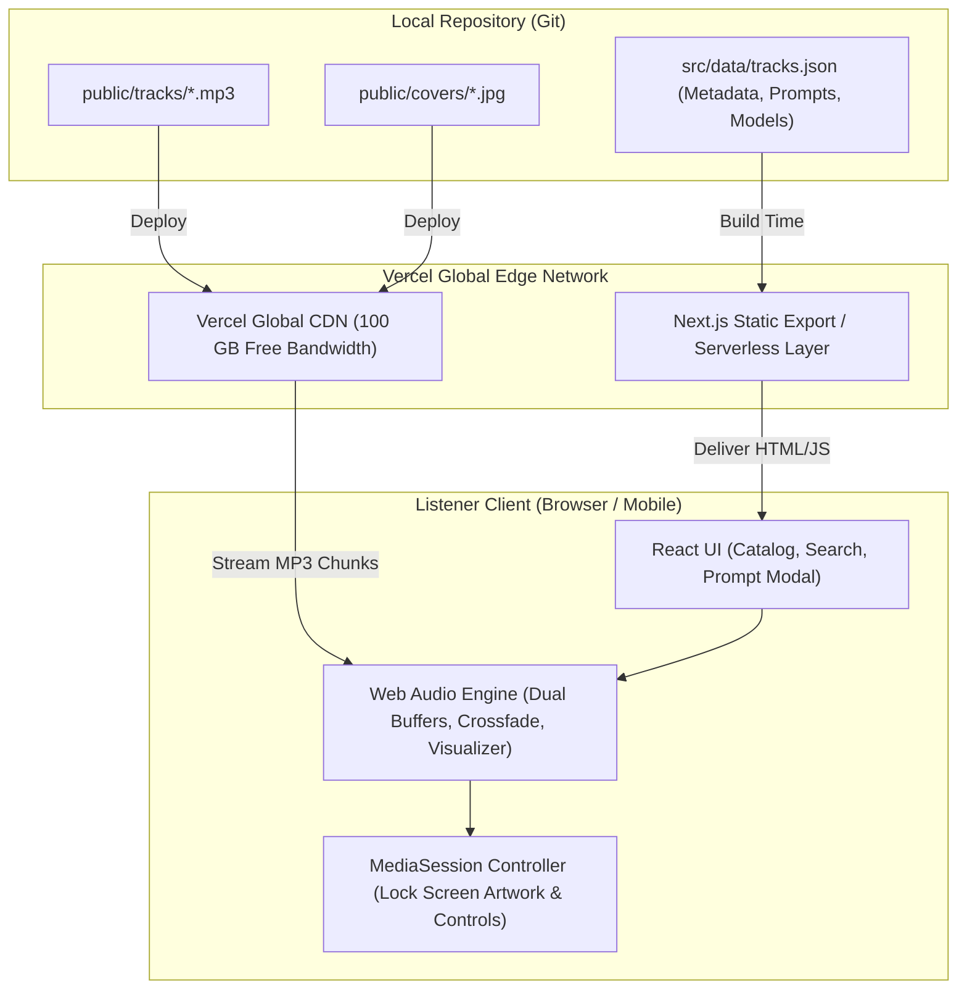

# System Design & Technical Architecture Document

## Project: NeuroWave AI Radio (Local-First Vercel Jukebox)
**Document Version:** 3.0.0 (Pure Local Static + Vercel Deployment)  
**Companion PRD:** [project.md](file:///d:/Projects/radio/docs/project.md)  
**Tech Stack:** Next.js 14+ (App Router), TypeScript, Tailwind CSS, Lucide React, Web Audio API.  
**Deployment Target:** Vercel (Edge CDN, $0/month, 100 GB Bandwidth).

---

## 1. System Architecture Overview

This architecture removes all external databases and server dependencies. All tracks, images, and metadata reside directly in the Git repository and are deployed to **Vercel**.



---

## 2. Directory & File Structure

```
radio/
├── public/
│   ├── tracks/                  # Your AI-generated MP3 files
│   │   ├── cyber-drift.mp3
│   │   ├── lofi-rain.mp3
│   │   └── ambient-void.mp3
│   └── covers/                  # Album art & thumbnails
│       ├── cyber-drift.jpg
│       ├── lofi-rain.jpg
│       └── ambient-void.jpg
├── src/
│   ├── app/
│   │   ├── layout.tsx           # Base HTML layout, fonts & metadata
│   │   ├── page.tsx             # Main Radio & Catalog page
│   │   └── globals.css          # Tailwind CSS styles & animations
│   ├── components/
│   │   ├── Header.tsx           # Logo, Genre Filters & Radio Mode Toggle
│   │   ├── TrackList.tsx        # Searchable, filterable track catalog
│   │   ├── TrackCard.tsx        # Individual track row with play trigger & prompt button
│   │   ├── Visualizer.tsx       # 60 FPS Canvas audio visualizer (bars & waves)
│   │   ├── PlayerBar.tsx        # Persistent audio player (progress bar, shuffle, volume)
│   │   └── PromptModal.tsx      # Modal to view & copy full AI prompts and lyrics
│   ├── hooks/
│   │   └── useAudioPlayer.ts    # Custom hook orchestrating playback, queue, and crossfade
│   ├── types/
│   │   └── track.ts             # TypeScript interfaces for Track and Playlist
│   └── data/
│       └── tracks.json          # Master track registry
├── package.json
├── tailwind.config.ts
└── tsconfig.json
```

---

## 3. Data Schema (`src/data/tracks.json`)

The single source of truth for all tracks:

```json
[
  {
    "id": "trk-01",
    "title": "Synthetic Rain",
    "artist": "NeuroWave Studio",
    "genre": "Synthwave",
    "mood": "Late Night",
    "duration": 215,
    "audioUrl": "/tracks/synthetic-rain.mp3",
    "coverUrl": "/covers/synthetic-rain.jpg",
    "aiModel": "Suno v3.5",
    "prompt": "80s retro synthwave, dark arpeggiated bassline, nostalgic rain atmosphere, 120 bpm",
    "lyrics": "[Verse 1]\nNeon reflects in the asphalt below\nCircuits alive in the midnight glow..."
  },
  {
    "id": "trk-02",
    "title": "Lo-Fi Coffee Code",
    "artist": "NeuroWave Studio",
    "genre": "Lofi",
    "mood": "Deep Focus",
    "duration": 182,
    "audioUrl": "/tracks/lofi-coffee-code.mp3",
    "coverUrl": "/covers/lofi-coffee-code.jpg",
    "aiModel": "Udio v1.5",
    "prompt": "Relaxing lofi study beat, mellow fender rhodes chords, gentle vinyl dust crackle, 80 bpm",
    "lyrics": null
  }
]
```

### TypeScript Interface (`src/types/track.ts`)
```typescript
export interface Track {
  id: string;
  title: string;
  artist: string;
  genre: string;
  mood: string;
  duration: number; // Duration in seconds
  audioUrl: string;
  coverUrl: string;
  aiModel: string;  // e.g. "Suno v3.5", "Udio v1.5"
  prompt: string;
  lyrics: string | null;
}
```

---

## 4. Audio Playback & "Radio Mode" Engine

### 4.1 State Machine
The core player state machine tracks:
* `currentTrack`: The actively playing `Track` object.
* `isPlaying`: Boolean play/pause state.
* `isRadioMode`: Boolean. When `true`:
  * Autoplays the next song when current track ends.
  * Shuffles through the selected genre or entire catalog.
  * Ensures no repeats until all tracks in the current pool have been played.
* `progress`: Current seek position in seconds.
* `volume`: 0.0 to 1.0.

### 4.2 Smooth Crossfade (Web Audio API)
To create an authentic radio broadcast feeling, the player uses a **Dual-Node Audio Context**:
1. When Track $A$ has 2 seconds remaining, Track $B$ begins buffering.
2. Track $B$ starts playing silently ($Gain = 0.0$) and ramps up to $1.0$ over 2 seconds.
3. Track $A$ ramps down from $1.0$ to $0.0$ and disconnects.
4. The listener experiences a seamless transition without abrupt silence.

---

## 5. Audio Visualizer Architecture

* Attached to the active `<audio>` element using `createMediaElementSource(audio)`.
* Routes through `AnalyserNode` with `fftSize = 256` (128 frequency bins).
* Canvas loop uses `requestAnimationFrame` to draw:
  * **Spectrum Mode:** Glowing neon vertical bars with peak smoothing.
  * **Waveform Mode:** Ambient oscilloscope wave.
* **Battery Saver:** Listens to `document.visibilityState`; pauses the canvas render loop when the browser tab is minimized or hidden, saving mobile battery.

---

## 6. Mobile & Lock Screen Integration (MediaSession API)

Enables full control and artwork display on iOS and Android lock screens:

```typescript
export function syncMediaSession(track: Track, onPlay: () => void, onPause: () => void, onNext: () => void, onPrev: () => void) {
  if (typeof window === 'undefined' || !('mediaSession' in navigator)) return;

  navigator.mediaSession.metadata = new MediaMetadata({
    title: track.title,
    artist: `${track.artist} (${track.aiModel})`,
    album: `NeuroWave FM • ${track.genre}`,
    artwork: [
      { src: track.coverUrl, sizes: '512x512', type: 'image/jpeg' }
    ]
  });

  navigator.mediaSession.setActionHandler('play', onPlay);
  navigator.mediaSession.setActionHandler('pause', onPause);
  navigator.mediaSession.setActionHandler('nexttrack', onNext);
  navigator.mediaSession.setActionHandler('previoustrack', onPrev);
}
```

---

## 7. Vercel Deployment & Caching Optimization

* **Static Assets Caching:** Configured in `next.config.mjs` to instruct Vercel's Edge CDN to cache `/tracks/*` and `/covers/*` aggressively:
  ```javascript
  headers: async () => [
    {
      source: '/tracks/:path*',
      headers: [
        { key: 'Cache-Control', value: 'public, max-age=31536000, immutable' },
        { key: 'Accept-Ranges', value: 'bytes' }
      ]
    }
  ]
  ```
* **Range Requests (Seeking):** Vercel natively supports `Accept-Ranges: bytes`, allowing users to jump directly to any second in a 5-minute song without downloading the entire file first.

---

## 8. Implementation Steps

1. **Step 1:** Initialize Next.js project with Tailwind CSS & TypeScript in `d:\Projects\radio`.
2. **Step 2:** Create sample audio tracks and cover placeholders in `/public/tracks` and `/public/covers`.
3. **Step 3:** Implement `useAudioPlayer` hook with playback, seeking, and Radio Mode queue logic.
4. **Step 4:** Build the UI components (`Header`, `TrackList`, `PlayerBar`, `Visualizer`, `PromptModal`).
5. **Step 5:** Test locally, verify mobile responsiveness and audio playback, and prepare for Vercel push.
